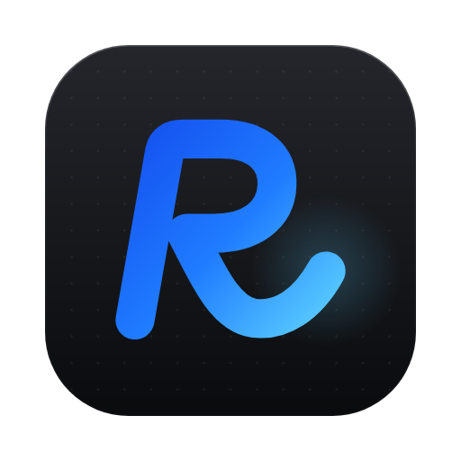

<p align="center"></p>

# RoTerminal for AI

Live data on every Roblox game, inside your AI. Players right now, each game's history, the games climbing fastest, what developers are making, genres and studios. From [roterminal.co](https://roterminal.co).

Ask things like:

- What Roblox games are trending right now?
- What Roblox game should I build next?
- How is Grow a Garden doing, and who are its rivals?
- Is horror taking off?

Free to start, no account needed.

## The fastest way

Paste this into Claude Code, Codex or Cursor:

```
Run npx roterminal. What Roblox games are trending right now?
```

## Install it

| Where | How |
|---|---|
| **Claude Code** (plugin: skill + connector) | `/plugin marketplace add elijahmadonia/roterminal-ai` then `/plugin install roterminal@roterminal` |
| **Claude** (web, desktop, phone) | Customize → Connectors → Add custom connector → `https://roterminal.co/mcp`, and pick "Sign in when needed" |
| **Any coding agent** (skill) | `npx skills add elijahmadonia/roterminal-ai` |
| **Claude Code** (connector only) | `claude mcp add --transport http roterminal https://roterminal.co/mcp` |
| **Codex** | `codex mcp add roterminal --url https://roterminal.co/mcp` |
| **Cursor** | [Add to Cursor](https://roterminal.co/add-to-cursor) |
| **Gemini CLI** | `gemini extensions install https://github.com/elijahmadonia/roterminal-ai` |
| **Your terminal** | `npx roterminal "grow a garden"` |

## What's in here

- `skills/roterminal/SKILL.md`: tells your agent when and how to use RoTerminal.
- `.mcp.json`: the connector, `https://roterminal.co/mcp` (remote MCP, OAuth for your own games).
- `.claude-plugin/`: the Claude Code plugin and its marketplace.
- `gemini-extension.json`, `GEMINI.md`: the Gemini CLI extension.
- `server.json`: the official MCP Registry listing.
- `cli/`: the source of the `roterminal` command on npm.

Every command, tool and reply format: [roterminal.co/agents.md](https://roterminal.co/agents.md)

## Limits

Without an account an address gets 50 calls a day. Signing in (free, `npx roterminal login`) gives 200, and paid plans more (up to 5,000 a day per seat). Every answer links back to its page on roterminal.co.

RoTerminal isn't affiliated with Roblox Corporation.
